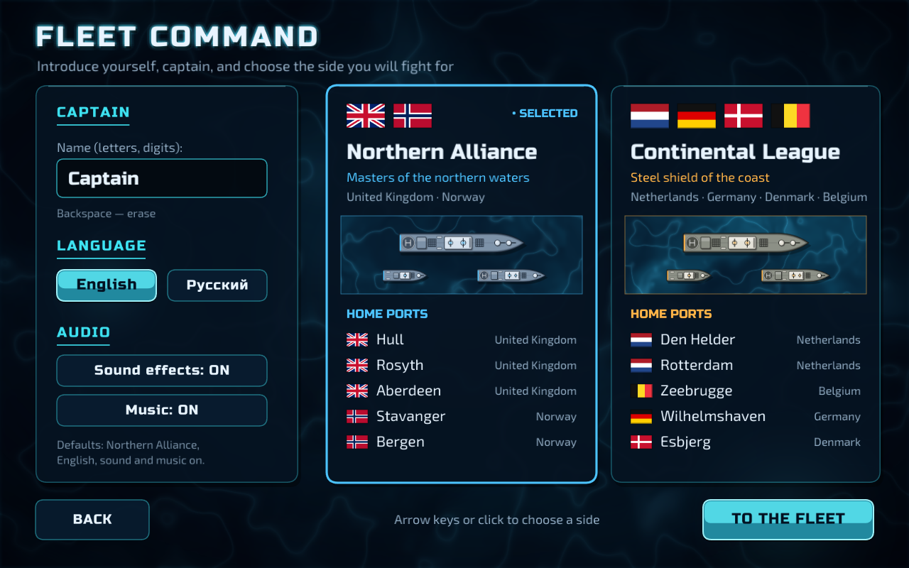
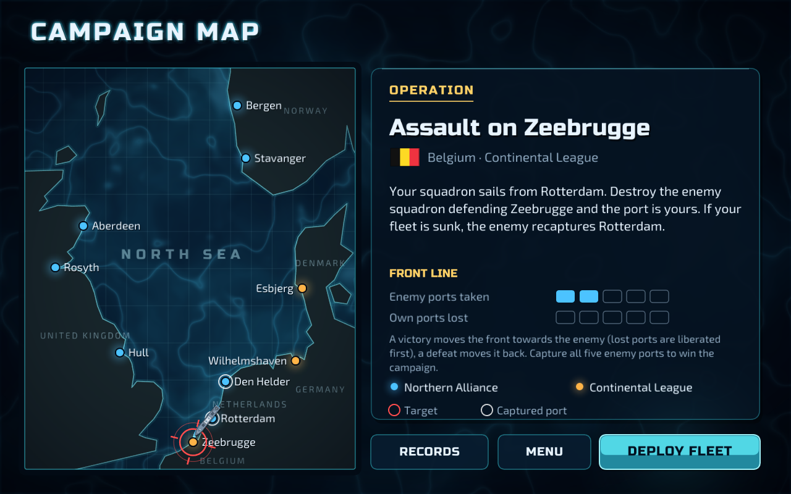
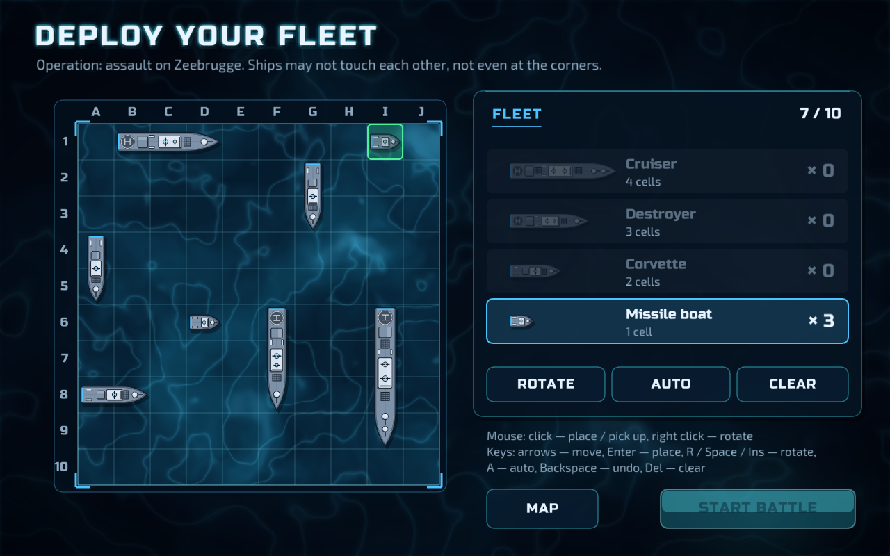
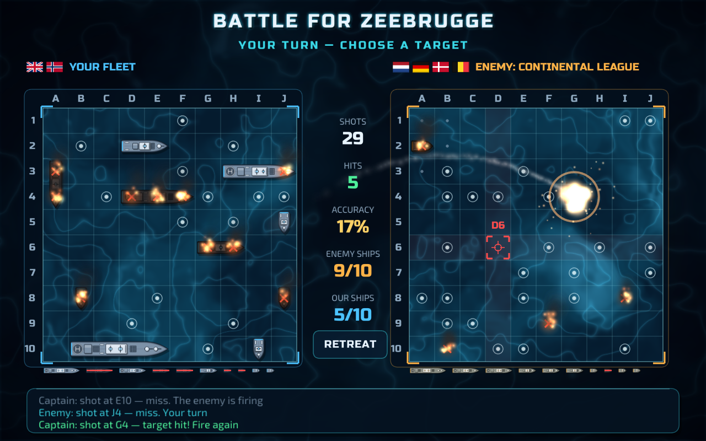

# North Sea Clash

[Русская версия](README.ru.md)

A modern naval battle game written in Go. Command the fleet of the **Northern Alliance** or the **Continental League**, deploy ten warships, trade missile salvoes with the enemy squadron and fight your way through a five-port campaign across the North Sea.

## Screenshots

| | |
|---|---|
|  |  |
| Choose your captain name and side | Campaign map of the North Sea |
|  |  |
| Fleet deployment | Battle |

## The two sides

The scenario is a fictional naval wargame between real maritime nations of the North Sea. All of these countries are allies in real life.

| | Northern Alliance | Continental League |
|---|---|---|
| Countries | United Kingdom, Norway | Netherlands, Germany, Denmark, Belgium |
| Ports (front line → rear) | Hull, Rosyth, Aberdeen, Stavanger, Bergen | Den Helder, Rotterdam, Zeebrugge, Wilhelmshaven, Esbjerg |
| Colour | Arctic blue, steel-blue hulls | Amber, storm-grey hulls |

**Defaults:** Northern Alliance, captain name "Captain", English interface, sound and music on. Your last name and side are remembered.

## How to play

1. **Title screen.** Press Enter or click. `L` switches the language.
2. **Fleet command.** Type your captain's name and choose a side.
3. **Naval database.** Your captain card (battles, victories, shots, best battle, campaign progress), the 6 best captains by victories and the 6 best battles by fewest shots.
4. **Campaign map.** The current operation is fought for the port on the front line. While the enemy holds any of your ports, you liberate them first, nearest first; then you storm the enemy's ports.
5. **Deployment.** Place your fleet:
   - 1 × Cruiser (4 cells)
   - 2 × Destroyer (3 cells)
   - 3 × Corvette (2 cells)
   - 4 × Missile boat (1 cell)

   Ships may not touch each other, not even at the corners. **Auto** places the fleet at random (the placement algorithm of the first version).
6. **Battle.** Click a cell of the enemy field to launch a missile. A hit lets you fire again; a miss passes the turn to the enemy, who also fires again after every hit. Sunk enemy ships are revealed, and the water around them is marked as empty. Each enemy missile starts from a random cell of the enemy field (water or ship alike), so launches never give away where its ships are.
7. **Result.** The campaign is a single front line between the two sides' ports.
   - **Victory:** the front moves one port towards the enemy. You either liberate one of your own ports or capture an enemy port.
   - **Defeat:** the front moves one port back. The enemy first recaptures its own ports, then takes yours.

   When all five enemy ports are captured (so all of yours are held), the campaign is won; when all five of your ports have fallen, it is lost. In both cases a campaign-end screen announces the result, and only its **New campaign** button starts the campaign over.

### Controls

| Key / mouse | Action |
|---|---|
| Mouse click | Place / pick up a ship, fire, press buttons |
| Right click, `R`, `Space`, `Insert`, `PageDown` | Rotate a ship during deployment |
| Arrow keys + `Enter` | Move the ship or the aiming cursor and place / fire (as in the first version) |
| `A` / `Del` / `Backspace` | Auto deployment / clear the field / undo the last ship |
| `Esc` | Back; in battle — retreat (counts as a defeat) |
| `F1` / `F2` | Sound effects on/off / music on/off |
| `F11` or `Alt+Enter` | Fullscreen |
| `L` | Switch language (title screen) |

Progress, records and settings are saved automatically in the user configuration folder:

- **Windows:** `%AppData%\NorthSeaClash\save.json`
- **Linux:** `~/.config/NorthSeaClash/save.json`
- **macOS:** `~/Library/Application Support/NorthSeaClash/save.json`

### Command-line options

| Option | Meaning |
|---|---|
| `--mute` | Start without audio. Use it on machines without a sound device; otherwise the audio driver error stops the game. |
| `--lang en` / `--lang ru` | Interface language |

## Building

You need **Go 1.25 or newer** and nothing else: no gcc, MinGW, Xcode or SDK. Dependencies (Ebitengine 2.10.5) are pinned in `go.mod` / `go.sum` and are downloaded on the first build.

### Windows

```powershell
$env:CGO_ENABLED="0"
go build -trimpath -ldflags="-s -w -H=windowsgui" -o NorthSeaClash.exe .
```

The same in `cmd.exe`:

```cmd
set CGO_ENABLED=0
go build -trimpath -ldflags="-s -w -H=windowsgui" -o NorthSeaClash.exe .
```

`-H=windowsgui` hides the console window. The `.syso` files give the executable its icon in Explorer.

### Linux and macOS

```sh
CGO_ENABLED=0 go build -trimpath -ldflags="-s -w" -o NorthSeaClash .
```

At runtime, Linux needs X11 (or XWayland) with OpenGL, and PulseAudio/PipeWire or ALSA for sound. On Debian/Ubuntu:

```sh
sudo apt install libx11-6 libgl1 libxcursor1 libxi6 libxinerama1 libxrandr2 libxrender1 libxext6
```

To run without building an executable, use `go run .` from a desktop session.

If Go reports a checksum or `go.sum` problem (for example after changing the Go version), run `go mod tidy` once and build again.

## Project structure

| File | Contents |
|---|---|
| `main.go` | Window, game loop, scene switching, input |
| `board.go` | Field model, `SetPole` placement, enemy commander (`AI`) |
| `theater.go` | Coalitions, countries, ports, North Sea coastline, flags, texts |
| `scene_title.go` | Animated title screen |
| `scene_setup.go` | Captain name, side, language, sound |
| `scene_card.go` | Captain card and records tables |
| `scene_map.go` | Campaign map |
| `scene_place.go` | Fleet deployment |
| `scene_battle.go` | Battle, turn order, results |
| `ships.go` | Vector warship sprites |
| `fx.go` | Particles: missiles, explosions, fire, smoke, splashes, wakes |
| `gfx.go` | Drawing helpers, ocean shader, buttons, panels, boards |
| `audio.go` | Synthesizer: sound effects and two music tracks |
| `text.go` | Text rendering from the pre-rendered font atlases |
| `records.go` | Settings, captain cards, records, campaign progress |
| `campaign.go` | Front line, port owners, campaign-end screen |
| `shots.go` | Screenshot tool (`go build -tags shots`, then run with `NSC_SHOTS=<dir>`) |
| `tools/genfont` | Generator of the font atlases in `assets/fonts` |
| `assets/` | Icon and font atlases |
| `screenshots/` | Screenshots |

### Regenerating the font atlases (optional)

The atlases in `assets/fonts` are already generated. To change the sizes or the character set:

```sh
go get golang.org/x/image@v0.45.0
go run tools/genfont/main.go tools/genfont/fonts/RussoOne-Regular.ttf tools/genfont/fonts/Exo2-Variable.ttf assets/fonts
go mod tidy
```

## Credits and licences

- **[Ebitengine](https://ebitengine.org)** 2D game engine — Apache License 2.0.
- **Fonts:** [Russo One](https://fonts.google.com/specimen/Russo+One) (Jovanny Lemonad) and [Exo 2](https://fonts.google.com/specimen/Exo+2) (The Exo 2 Project Authors), SIL Open Font License 1.1. The licence texts are in `assets/fonts`.
