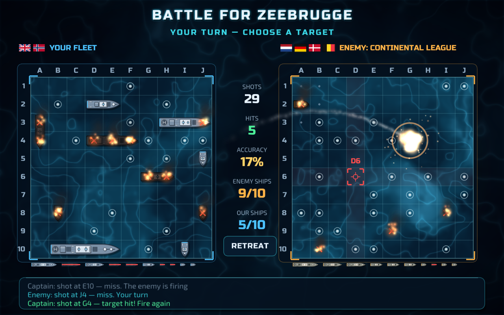
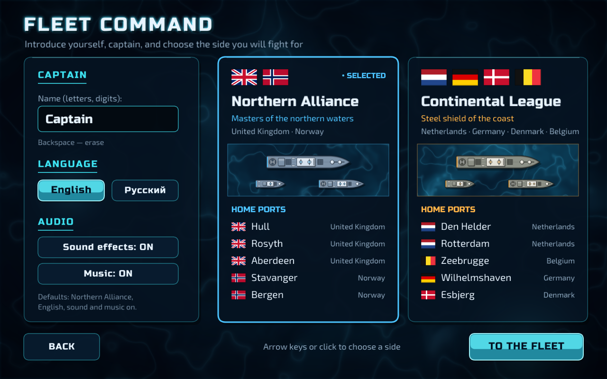
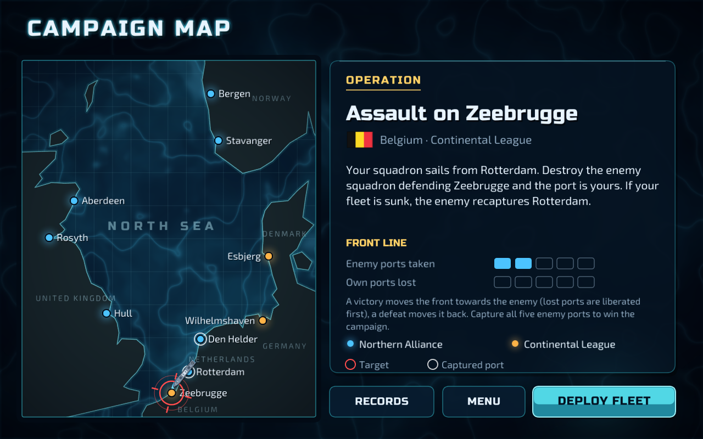
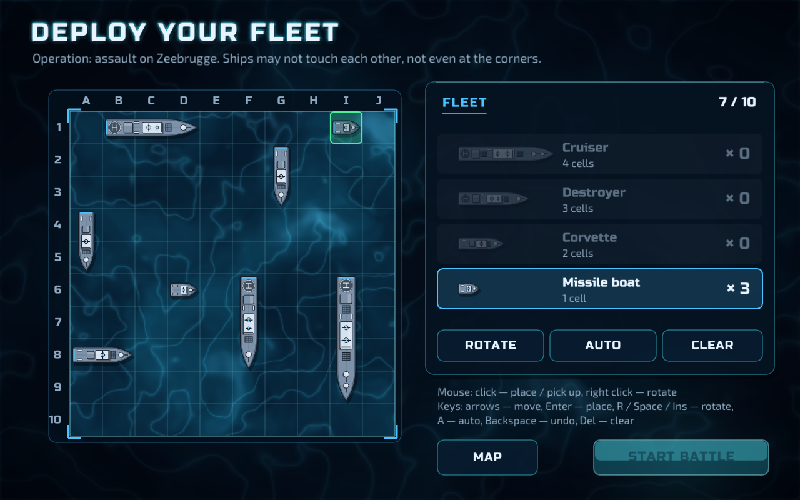

# Битва в Северном море (North Sea Clash)

[English version](README.md)

Современный морской бой на Go. Возглавьте флот **Северного альянса** или **Континентальной лиги**, расставьте десять боевых кораблей, обменяйтесь ракетными залпами с эскадрой противника и пройдите кампанию за пять портов Северного моря.

## Скриншоты

| | |
|---|---|
|
|  |  |
| Имя капитана и выбор стороны | Карта кампании |
|  |  |
| Расстановка флота | Бой |

## Стороны

Сценарий — вымышленные военно-морские учения между реальными морскими державами Северного моря. В действительности все эти страны — союзники.

| | Северный альянс | Континентальная лига |
|---|---|---|
| Страны | Великобритания, Норвегия | Нидерланды, Германия, Дания, Бельгия |
| Порты (от линии фронта в тыл) | Халл, Росайт, Абердин, Ставангер, Берген | Ден-Хелдер, Роттердам, Зебрюгге, Вильгельмсхафен, Эсбьерг |
| Цвет | Арктический синий, стально-синие корпуса | Янтарный, штормово-серые корпуса |

**По умолчанию:** Северный альянс, имя капитана «Captain» (в русском интерфейсе — «Капитан»), английский язык, звук и музыка включены. Последние имя и сторона запоминаются.

## Как играть

1. **Заставка.** Нажмите Enter или щёлкните мышью. Клавиша `L` переключает язык.
2. **Командование флотом.** Введите имя капитана и выберите сторону.
3. **Морская база данных.** Ваша карточка (бои, победы, выстрелы, лучший бой, ход кампании), 6 лучших капитанов по числу побед и 6 лучших боёв по наименьшему числу выстрелов.
4. **Карта кампании.** Текущая операция идёт за порт на линии фронта. Пока противник удерживает ваши порты, вы сначала освобождаете их, начиная с ближайшего, и только потом штурмуете порты противника.
5. **Расстановка.** Разместите флот:
   - 1 крейсер (4 клетки)
   - 2 эсминца (3 клетки)
   - 3 корвета (2 клетки)
   - 4 ракетных катера (1 клетка)

   Корабли не должны касаться друг друга, даже углами. Кнопка **Авто** расставляет флот случайно (алгоритм расстановки первой версии).
6. **Бой.** Щёлкните по клетке поля противника, чтобы запустить ракету. После попадания вы стреляете снова; после промаха ход переходит к противнику, который тоже повторяет выстрел после каждого попадания. Потопленные корабли врага открываются, а вода вокруг них отмечается как пустая. Каждая ракета противника стартует со случайной клетки его поля (вода это или корабль — неважно), поэтому пуски не выдают расположение его кораблей.
7. **Итог.** Кампания — это одна линия фронта между портами двух сторон.
   - **Победа:** фронт сдвигается на один порт к противнику. Вы освобождаете один из своих портов или захватываете порт противника.
   - **Поражение:** фронт отходит на один порт назад. Противник сначала отбивает свои порты, затем захватывает ваши.

   Когда захвачены все пять портов противника (а значит, все ваши удержаны), кампания выиграна; когда пали все пять ваших портов — проиграна. В обоих случаях итог объявляет экран конца кампании, и только его кнопка **Новая кампания** начинает кампанию заново.

### Управление

| Клавиша / мышь | Действие |
|---|---|
| Щелчок мышью | Поставить / поднять корабль, выстрел, кнопки |
| Правая кнопка, `R`, `Пробел`, `Insert`, `PageDown` | Повернуть корабль при расстановке |
| Стрелки + `Enter` | Двигать корабль или прицел и ставить / стрелять (как в первой версии) |
| `A` / `Del` / `Backspace` | Автоматическая расстановка / очистить поле / убрать последний корабль |
| `Esc` | Назад; в бою — отступление (засчитывается поражение) |
| `F1` / `F2` | Звуковые эффекты вкл/выкл / музыка вкл/выкл |
| `F11` или `Alt+Enter` | Полноэкранный режим |
| `L` | Сменить язык (на заставке) |

Прогресс, рекорды и настройки сохраняются автоматически в папке настроек пользователя:

- **Windows:** `%AppData%\NorthSeaClash\save.json`
- **Linux:** `~/.config/NorthSeaClash/save.json`
- **macOS:** `~/Library/Application Support/NorthSeaClash/save.json`

### Параметры запуска

| Параметр | Значение |
|---|---|
| `--mute` | Запуск без звука. Нужен на компьютерах без звуковой карты, иначе ошибка звукового драйвера остановит игру. |
| `--lang en` / `--lang ru` | Язык интерфейса |

## Сборка

Нужен только **Go 1.25 или новее**: без gcc, MinGW, Xcode и SDK. Зависимости (Ebitengine 2.10.5) зафиксированы в `go.mod` / `go.sum` и скачиваются при первой сборке.

### Windows

```powershell
$env:CGO_ENABLED="0"
go build -trimpath -ldflags="-s -w -H=windowsgui" -o NorthSeaClash.exe .
```

То же в `cmd.exe`:

```cmd
set CGO_ENABLED=0
go build -trimpath -ldflags="-s -w -H=windowsgui" -o NorthSeaClash.exe .
```

`-H=windowsgui` убирает консольное окно. Файлы `.syso` дают исполняемому файлу значок в Проводнике.

### Linux и macOS

```sh
CGO_ENABLED=0 go build -trimpath -ldflags="-s -w" -o NorthSeaClash .
```

Для запуска в Linux нужны X11 (или XWayland) с OpenGL и PulseAudio/PipeWire или ALSA для звука. В Debian/Ubuntu:

```sh
sudo apt install libx11-6 libgl1 libxcursor1 libxi6 libxinerama1 libxrandr2 libxrender1 libxext6
```

Чтобы запустить без сборки исполняемого файла, выполните `go run .` в графическом сеансе.

Если Go сообщает о проблеме с контрольными суммами или `go.sum` (например, после смены версии Go), выполните один раз `go mod tidy` и соберите заново.

## Структура проекта

| Файл | Содержимое |
|---|---|
| `main.go` | Окно, игровой цикл, смена экранов, ввод |
| `board.go` | Модель поля, расстановка `SetPole`, командир противника (`AI`) |
| `theater.go` | Коалиции, страны, порты, береговая линия, флаги, тексты |
| `scene_title.go` | Анимированная заставка |
| `scene_setup.go` | Имя капитана, сторона, язык, звук |
| `scene_card.go` | Карточка капитана и таблицы рекордов |
| `scene_map.go` | Карта кампании |
| `scene_place.go` | Расстановка флота |
| `scene_battle.go` | Бой, очерёдность ходов, итоги |
| `ships.go` | Векторные спрайты кораблей |
| `fx.go` | Частицы: ракеты, взрывы, огонь, дым, всплески, кильватерный след |
| `gfx.go` | Вспомогательная графика, шейдер воды, кнопки, панели, поля |
| `audio.go` | Синтезатор звуковых эффектов и двух музыкальных тем |
| `text.go` | Вывод текста из заранее отрисованных шрифтовых атласов |
| `records.go` | Настройки, карточки капитанов, рекорды, ход кампании |
| `campaign.go` | Линия фронта, владельцы портов, экран конца кампании |
| `shots.go` | Инструмент скриншотов (`go build -tags shots`, затем запуск с `NSC_SHOTS=<папка>`) |
| `tools/genfont` | Генератор шрифтовых атласов для `assets/fonts` |
| `assets/` | Значок и шрифтовые атласы |
| `screenshots/` | Скриншоты |

### Пересоздание шрифтовых атласов (необязательно)

Атласы в `assets/fonts` уже сгенерированы. Чтобы изменить размеры или набор символов:

```sh
go get golang.org/x/image@v0.45.0
go run tools/genfont/main.go tools/genfont/fonts/RussoOne-Regular.ttf tools/genfont/fonts/Exo2-Variable.ttf assets/fonts
go mod tidy
```

## Авторы и лицензии

- **[Ebitengine](https://ebitengine.org)** — 2D-движок, лицензия Apache 2.0.
- **Шрифты:** [Russo One](https://fonts.google.com/specimen/Russo+One) (Jovanny Lemonad) и [Exo 2](https://fonts.google.com/specimen/Exo+2) (The Exo 2 Project Authors), лицензия SIL Open Font License 1.1. Тексты лицензий лежат в `assets/fonts`.
